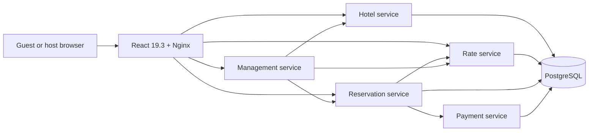

# Vela House — Hotel Reservation System

A hotel reservation platform inspired by ByteByteGo's [Hotel Reservation System](https://bytebytego.com/courses/system-design-interview/hotel-reservation-system). Guests can search Brazilian coastal stays and dates, compare live room availability and rates, make idempotent reservations, view or cancel trips, and hosts can manage hotels, rooms, rates, and reservations. Payments use a local simulator and demo tokens; the application does not collect real card numbers.

The web experience is a React 19.3 single-page app, the APIs are five Rust microservices, and PostgreSQL stores each service's data in a separate database. The design handoff lives in `design/opendesign/` and the React implementation uses optimized WebP photo assets.

## Case study and known defects

This is the **Rust greenfield** implementation in [One Hotel Design, Five AI Implementations](https://marcelomiyake.com.br/posts/five-ai-hotel-implementations/), which compares five AI-built versions of the same hotel design, and in its [Part II on the cost of a new feature](https://marcelomiyake.com.br/posts/five-ai-hotel-implementations-part-2/). Part I inspected commit [`961071e`](https://github.com/marcelomiyake/hotel-rust-greenfield/commit/961071eaa773c6f0e37c438da8336d2ac2f466eb).

Of the three implementations the study could probe, this was the only one that kept inventory correct when two requests cancelled the same reservation at once. The study also found:

- Replaying a completed, paid booking returned HTTP 502 while the rate service was down, because current rates are loaded before the idempotency check.
- When the payment call fails, the booking stays `pending` with its inventory reserved; nothing expires or reconciles it.
- Anyone who knows a reservation's UUID can read it; there is no guest authentication.
- The database tests return early, and pass, when their database environment variables are missing.
- Part II: abandonment-analytics completion shares the paid-state transaction, so an analytics database error can roll back the local paid state after the payment call has returned (from source review).

No later commit fixes these. The passing tests and SonarQube Cloud results below do not cover them. This is a local learning implementation, not a production system.

## Architecture



| Component | Responsibility |
| --- | --- |
| `hotel-service` | Hotel and room catalog, property data, health endpoint |
| `rate-service` | Date-based nightly rates and rate management |
| `reservation-service` | Availability, idempotent booking, trip lookup and cancellation |
| `payment-service` | Simulated payment and refund records |
| `management-service` | Host overview and staff operations across services |
| `hotel-common` | Shared validation, date, authentication and error helpers |
| `web/` | Responsive guest and host experience, API client, metadata and assets |

Each Rust service owns its schema and database (`hotel_service`, `rate_service`, `reservation_service`, and `payment_service`). Reservation requests coordinate availability, rates, and the payment simulator. Nginx serves the SPA and proxies same-origin `/api` requests to the services.

## Run locally

Requirements: Rust toolchain from `rust-toolchain.toml`, Docker, Node.js 20.19+, npm, Kind, and kubectl.

### Kubernetes on Kind

The `hotel-system` Kind cluster should exist before deploying. The setup script builds and loads local images, applies the `hotel-rust` namespace and manifests, then waits for rollouts.

```sh
kind create cluster --name hotel-system
./scripts/kind-up.sh
```

There are two replicas for each of the five Rust microservices and the web deployment. PostgreSQL runs as a single-replica StatefulSet with a persistent volume. In another terminal:

```sh
./scripts/kind-port-forward.sh
```

Open <http://127.0.0.1:4173/>. The local staff token is `local-kind-staff-token-change-me`; change the demo secret before exposing this stack beyond localhost.

### Docker Compose

```sh
docker compose up --build
```

Open <http://127.0.0.1:8088/>. Compose exposes PostgreSQL on `127.0.0.1:55433` for local tests.

## Tests and coverage

Rust tests exercise request validation, booking and cancellation behavior, idempotency, and simulated payment flows using PostgreSQL-backed test databases. The React tests use Vitest and Testing Library.

| SonarCloud project | Coverage | Open issues |
| --- | ---: | ---: |
| [hotel-service](https://sonarcloud.io/project/overview?id=marcelomiyake_hotel-rust_hotel-service) | 99.5% | 0 |
| [rate-service](https://sonarcloud.io/project/overview?id=marcelomiyake_hotel-rust_rate-service) | 100.0% | 0 |
| [reservation-service](https://sonarcloud.io/project/overview?id=marcelomiyake_hotel-rust_reservation-service) | 96.5% | 0 |
| [payment-service](https://sonarcloud.io/project/overview?id=marcelomiyake_hotel-rust_payment-service) | 99.5% | 0 |
| [management-service](https://sonarcloud.io/project/overview?id=marcelomiyake_hotel-rust_management-service) | 99.2% | 0 |
| [hotel-common](https://sonarcloud.io/project/overview?id=marcelomiyake_hotel-rust_hotel-common) | 91.0% | 0 |
| [web](https://sonarcloud.io/project/overview?id=marcelomiyake_hotel-rust_web) | 91.7% | 0 |

All seven [SonarCloud monorepo projects](https://sonarcloud.io/organizations/marcelomiyake/projects?sort=-analysis_date) report zero open issues. The 2026-10-01 analysis also reported zero bugs, vulnerabilities, and code smells, with all seven quality gates passing. Overall coverage exceeds 90% in every project. [SonarQube Cloud automatic analysis does not support Rust](https://docs.sonarsource.com/sonarqube-cloud/analyzing-source-code/automatic-analysis#supported-languages), so Rust LCOV reports are generated with `cargo llvm-cov` and imported with `cargo sonar-scanner`. To run the full sequence locally, start the Compose PostgreSQL test database and set `SONAR_TOKEN`, then run:

```sh
docker compose up -d --wait postgres
./scripts/sonar-analyze.sh
```

The GitHub Actions workflow is in `.github/workflows/sonarcloud.yml`; add a repository Actions secret named `SONAR_TOKEN` to enable its scans. No token is stored in this repository.

## Lighthouse and search metadata

Lighthouse 13.5.0 was run against the Compose deployment on 2026-10-01. Scores below are the observed local results. Lighthouse's Agentic Browsing category is experimental; its scoring is described in [Chrome's Lighthouse documentation](https://developer.chrome.com/docs/lighthouse/agentic-browsing/scoring).

| Form factor | Performance | Accessibility | Best Practices | SEO | Agentic Browsing |
| --- | ---: | ---: | ---: | ---: | ---: |
| Desktop | 100 | 100 | 100 | 100 | 100 |
| Mobile | 100 | 100 | 100 | 100 | 100 |

The frontend has page titles, description and social metadata, structured organization data, `robots.txt`, and `llms.txt`. Image sizes and responsive WebP sources are set to keep the initial page light.


## Reservation abandonment analytics

The booking flow now records an anonymous journey when the reservation form opens. PostgreSQL stores a compact current-state row in `reservation_journeys` and an append-only event history in `reservation_journey_events`. The journey ID is a random UUID; the analytics events contain hotel and room IDs and the last checkout screen, with no guest name, email address, or payment token.

Screen focus and form activity update the last screen to `guest_details` or `payment`. Same-screen activity heartbeats are rate-limited to once per minute, while section transitions are recorded immediately. When the reservation service confirms a successful payment, it marks the journey completed in the same transaction. A journey is considered abandoned after 30 minutes without activity and remains queryable through the `abandoned_reservation_journeys` view. No administrative frontend was added.

The application sends `POST /api/reservation-journeys` to start a journey and `POST /api/reservation-journeys/{journey_id}/screens` on section transitions and periodic activity heartbeats. The reservation service routes these to `/v1/reservation-journeys` and `/v1/reservation-journeys/{journey_id}/screens`.

Example database query for bookings left in the payment section:

```sql
SELECT journey_id, hotel_id, room_type_id, last_screen, started_at, last_activity_at
FROM abandoned_reservation_journeys
WHERE last_screen = 'payment'
ORDER BY last_activity_at DESC;
```

## AI build record

This implementation was generated with Codex (GPT-6 Luna, max effort). The original prompts, token usage, cost estimates, and change counts for the initial build and the reservation-abandonment feature are in [docs/ai-build-record.md](docs/ai-build-record.md).
